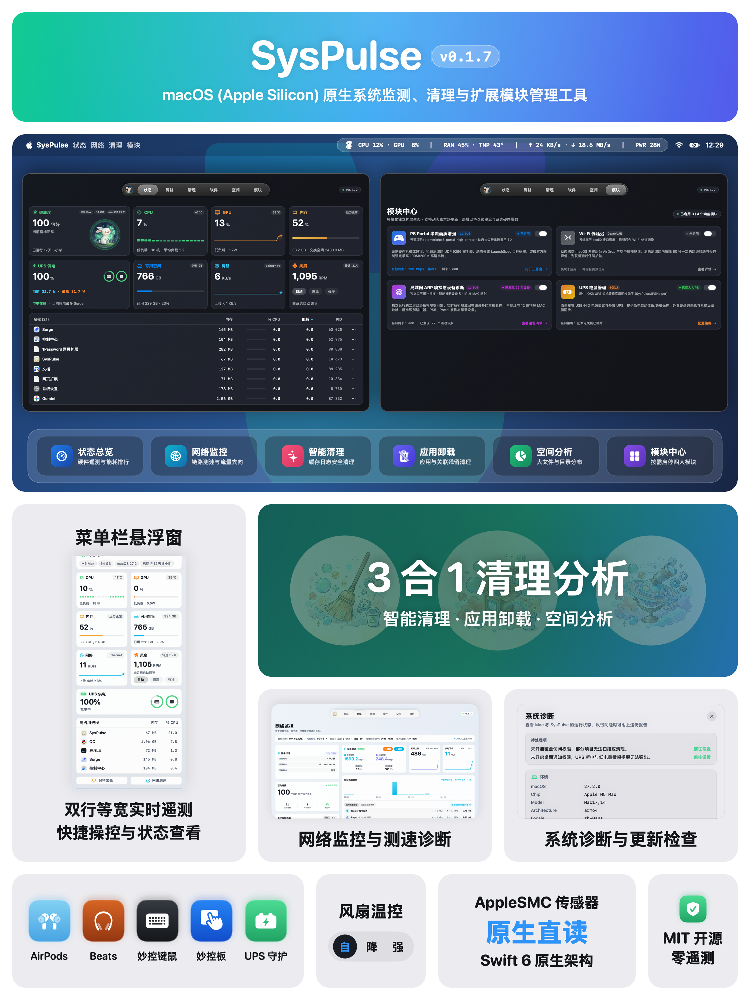

<div align="center">
  
  <h1>SysPulse</h1>
  <p><strong>macOS (Apple Silicon) 系统监测、清理与扩展模块管理工具</strong></p>

  <p>
    <a href="https://github.com/Rabbit-Spec/macOS-SysPulse/releases"></a>
    <a href="https://github.com/Rabbit-Spec/macOS-SysPulse/blob/main/LICENSE"></a>
    
    <a href="https://space.bilibili.com/7135720"></a>
  </p>
</div>

<p align="center">
  
</p>

---

## 功能说明

### 1. 状态总览与菜单栏 HUD
- **健康度评估**：综合 CPU 负载、内存压力、运行温度、磁盘余量与开机时长计算评分，显示 4 档兔兔状态图标。
- **菜单栏显示**：支持双行等宽显示 `CPU / GPU`、`RAM / TMP`、`上下行网速` 与 `实时功耗 / 峰值功耗`。
- **传感器读取**：通过 AppleSMC 读取 CPU/GPU 核心温度与风扇转速，支持 **自动 / 散热 / 全速** 模式切换。
- **外设电量显示**：识别并展示 AirPods (1-4 / Pro / Max)、Beats 耳机、妙控键盘、妙控鼠标、妙控板电量。
- **供电状态显示**：Mac 台式机默认显示 **AC 供电（市电在线）**，MacBook 显示内置 **电池**（充满或优化充电保持时显示 **AC 适配器供电**）；在模块中心启用 UPS 电源管理并接入外置 UPS 后显示 **UPS 供电**（MacBook 内置电池未充满时优先显示电池状态，充满后切换为 UPS 状态），主窗口与菜单栏卡片文案完全统一。

### 2. 网络监控与测速诊断
- **流量排行与连接查看**：按应用或活跃 Socket 连接统计实时上下行带宽与累计流量，记录 24 小时分时流量趋势，支持定位进程路径。
- **网络测速**：调用 macOS 原生 `networkQuality` 测量上下行带宽、链路延迟 (RPM) 与抖动。

### 3. 系统清理、软件管理与空间分析
- **智能清理**：内置 `FolderNotes.json` 应用与目录语义库，配合 8 阶段实时扫描进度面板与多层安全清理守卫（`CleanWhitelistMatcher`），扫描系统/用户缓存、Xcode 派生数据、日志、废纸篓与浏览器缓存，支持「清理保护」白名单与移至废纸篓/删除两种模式。
- **软件管理**：整合 **已安装应用、命令行工具（内置 191 项 CLI 图标）、无主残留、启动项管理** 四大视图，支持联动 `brew uninstall --cask --zap` 卸载、仅清理应用数据保留本体、以及 `LaunchAgents` / `LaunchDaemons` / `LoginItems` 启停与失效配置清理。
- **空间分析**：统计目录层级体积分布与缓存构成、文件类型、巨型文件 Top 50 三维洞察，显式标注受 TCC 保护目录并支持大型软件包后台渐进核算。

### 4. 模块中心（按需启用，支持拖拽排序）
首次安装后七个功能模块均处于未启用状态，未启用时不启动后台定时任务与硬件轮询；用户可在顶部导航栏 **「模块」**（`⌘6`）按需开启、停用或长按拖拽自定义卡片排列顺序：

- **PS Portal 串流画质增强（v0.1.5）**
  - 原生 C BPF 注入引擎，支持 **单向视频直连**、**双向遥测验证** 与 **纯旁路只读 BPF 自动增强守望（`--watch`）**。
  - 兼容 IPv4 分片 `LaunchSpec` 协议载荷与自适应码率字段替换，支持 `65 Mbps`、`100 Mbps`、`200 Mbps` 目标码率档位。
  - 集成 **PlayStation DDP（UDP 9302）+ TCP 9295 + 全量 SIE 硬件 OUI** 精准设备识别、120 秒握手等待实时倒计时、以及工作台 **Debug 诊断模式**与日志文件落盘（`~/Library/Logs/SysPulse/psportal.log`）。
- **Wi-Fi 低延迟（v0.1.1）**
  - 控制 macOS `awdl0` 接口开关，暂停后台隔空扫描与信道切换。
  - 停用模块或退出应用时自动恢复 `awdl0` 状态。
- **局域网 ARP 嗅探与设备诊断（v0.1.3）**
  - 内置权威 **54,000+ 条 IEEE OUI（MA-L / MA-M / MA-S）硬件厂商数据库**，结合 **UPnP XML / mDNS / NetBIOS / 路由器 DNS PTR** 多协议设备主动自报，精准还原设备型号、名称与厂商。
  - 列表按 IPv4 地址升序排序，支持点击复制 IP / MAC 地址、关键字过滤、单台设备改名、自定义厂商与全局 **「厂商名称 / MAC 前缀」映射规则** 及上传本地图片作为图标，支持导入路由器 DHCP 静态分配 `.csv` 备份。
- **UPS 电源管理（v0.1.7）**
  - 优先通过 macOS 原生 `IOPowerSources` 读取 APC、Santak（山特）、CyberPower、Eaton 等 USB UPS 设备并兼容直接 USB-HID 回退，同步显示电压、负载功耗、电池电量与预计续航；接入睡眠/息屏生命周期管理，避免睡眠期间 USB 阻塞。
  - 支持配置断电阈值（使用时间、剩余时间、剩余电量百分比），触发后可执行外置硬盘安全弹出、发送关机通知、安全睡眠或关机操作，并无感同步至系统设置。
  - 内置 **外置硬盘逃生舱**，以两列卡片展示已挂载外置磁盘及容量，支持断电延时自动卸载与单盘单独推出。
- **Antigravity 上下文扩容（v0.1.1）**
  - 纯 Swift 原生 Mach-O ARM64 二进制与 Go `pclntab` 符号定位引擎，无需 Python 环境即可解除 Antigravity 语言服务 `GetCheckpointConfig` 256K 上下文限制（支持全量 ~983K、900K、512K 与自定义阈值，修改前自动创建备份）。
  - 自动记忆与检测 Antigravity 客户端版本号及生效状态，应用更新后进入模块可及时提示重新解锁。
- **AI 工具清理与维护（v0.1.2）**
  - 针对 Claude、Codex、Cursor、Antigravity / Gemini、Ollama、Hugging Face、PyTorch 等 AI 客户端与模型运行环境提供专用缓存、日志、会话历史及已卸载工具残留扫描与安全清理。
- **软件更新中心（v0.1.2）**
  - 覆盖 Homebrew Cask / CLI、Mac App Store、Sparkle、Electron 及官网 / Cask 清单五级独占更新渠道，支持严格签名与 Apple Silicon 架构校验、原子替换升级及厂商安装器引导。

### 5. 系统诊断、权限管理与生命周期优化
- **系统运行诊断**：汇总硬件规格、传感器、权限、安全设置与运行状态，支持复制 Markdown 格式诊断报告。
- **权限与自启动管理**：集中检测与申请完全磁盘访问、蓝牙、桌面通知、Apple Events、SMC 风扇助手与开机自启动权限。
- **睡眠唤醒与后台低功耗控制**：监听系统睡眠/唤醒及息屏通知、窗口遮挡状态与蓝牙/UPS 查询节流，窗口隐藏或系统入睡时自动停止后台轮询与 UI 重绘。

---

## 下载与安装

1. 前往 [**GitHub Releases**](https://github.com/Rabbit-Spec/macOS-SysPulse/releases) 页面下载 `SysPulse-v0.1.15.dmg`。
2. 双击打开 DMG 镜像，将 **`SysPulse.app`** 拖入 **`Applications`（应用程序）** 文件夹。
3. 首次打开如果遇到 macOS 未签名开发者提示，可在终端运行以下命令放行：
   ```bash
   sudo xattr -rd com.apple.quarantine /Applications/SysPulse.app
   ```

---

## 从源码编译

SysPulse 使用 **Swift 6 + SwiftUI + AppKit + IOKit** 编写：

```bash
git clone https://github.com/Rabbit-Spec/macOS-SysPulse.git
cd macOS-SysPulse
./scripts/build_app.sh release
```

编译完成后，生成的应用包与 DMG 镜像位于 `../build/` 目录下。

---

## 作者与开源协议

- **作者**：[Rabbit-Spec](https://github.com/Rabbit-Spec)
- **Bilibili 频道**：[汤圆_Lyric](https://space.bilibili.com/7135720)
- **开源协议**：本项目基于 [MIT License](LICENSE) 开源。
- **功能参考**：「CleanMyMac」、「Mole」、「Cleer」、「Surge」
