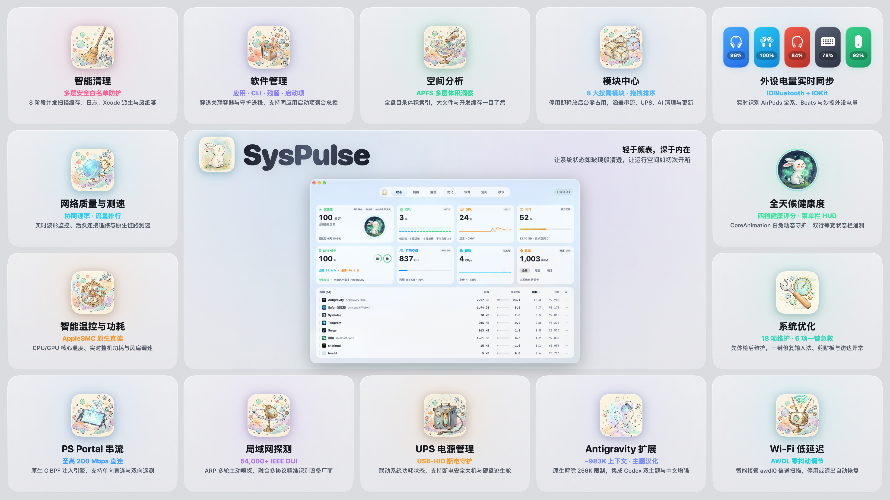

<div align="center">
  
  <h1>SysPulse</h1>
  <p><strong>macOS (Apple Silicon) 系统监测、清理与扩展模块管理工具</strong></p>

  <p>
    <a href="https://github.com/Rabbit-Spec/macOS-SysPulse/releases"></a>
    <a href="https://github.com/Rabbit-Spec/macOS-SysPulse/blob/main/LICENSE"></a>
    
    <a href="https://space.bilibili.com/7135720"></a>
  </p>
</div>

<p align="center">
  <picture>
    <source media="(prefers-color-scheme: dark)" srcset="Resources/SysPulse-Keynote-Dark.png" />
    <source media="(prefers-color-scheme: light)" srcset="Resources/SysPulse-Keynote-Light.png" />
    
  </picture>
</p>

---

## 功能说明

### 1. 状态总览与菜单栏 HUD
- **健康度评估**：综合 CPU 负载、内存压力、运行温度、磁盘余量与开机时长计算评分，显示 4 档兔兔状态图标；新增 Apple Silicon **CPU 双核心群组拓扑识别**（超级核蓝色 / 性能核绿色）及菜单栏更新提醒横幅。
- **菜单栏显示**：支持双行等宽显示 `CPU / GPU`、`RAM / TMP`、`上下行网速` 与 `实时功耗 / 峰值功耗`，窗口退到后台或被完全遮挡时自动暂停高消耗动效。
- **传感器读取**：通过 AppleSMC 读取 CPU/GPU 核心温度与风扇转速，支持 **自动 / 散热 / 全速** 模式切换。
- **外设电量显示**：识别并展示 AirPods (1-4 / Pro / Max)、Beats 耳机、遥控器、妙控键盘、妙控鼠标、妙控板电量；无内建电池 Mac 上支持展示最多 **5 台**蓝牙设备。
- **供电状态显示**：Mac 台式机默认显示 **AC 供电（市电在线）**，MacBook 显示内置 **电池**（充满或优化充电保持时显示 **AC 适配器供电**）；在模块中心启用 UPS 电源管理并接入外置 UPS 后显示 **UPS 供电**（MacBook 内置电池未充满时优先显示电池状态，充满后切换为 UPS 状态），主窗口与菜单栏卡片文案完全统一；笔记本 KeepAwake 模式额外支持合盖防休眠与门户守望互斥协同。

### 2. 网络监控与测速诊断
- **流量排行与连接查看**：按应用或活跃 Socket 连接统计实时上下行带宽与累计流量（开启 TUN 代理时优先统计物理网卡并限流，避免网速虚高），记录 24 小时分时流量趋势，支持定位进程路径，进程列表批量刷新防闪烁。
- **网络测速**：调用 macOS 原生 `networkQuality` 测量上下行带宽、链路延迟 (RPM) 与抖动。

### 3. 系统清理、系统优化、应用管理与空间分析
- **智能清理**：内置 `FolderNotes.json` 应用与目录语义库，配合 8 阶段实时扫描（高响应分片并发大幅提速）与多层安全清理守卫（`CleanWhitelistMatcher`），扫描系统/用户缓存、Xcode 派生数据、日志、废纸篓与全系 Chromium 浏览器缓存（Chrome Canary / Edge Beta 等）；支持「清理保护」`+` 手动选入文件/文件夹、操作队列自动排队接续、运行中应用可再释放空间提示及后台活跃服务拦截。
- **系统优化**：采用「先体检、后维护」的双栏透明工作台，内置 4 大分组共 **18 项系统预检维护**（清理打开方式残留应用、失效后台服务与 `bin/sbin` 悬空软链接、损坏偏好配置与最近列表隔离至废纸篓、30 天旧窗口状态与超期通知清理、下载隔离记录清空、闲置 DMG 推出、邮件与信息数据库无损压缩、残留 Spotlight 规则清理、快速查看与缩略图图标缓存刷新、DNS 缓存刷新及主目录权限/周期维护/内存释放智能按需执行）与右侧常驻 **6 项「修复小毛病」一键急救**（输入法、通知中心、通用剪贴板、Spotlight、访达与程序坞、控制中心）；支持一次性 Touch ID 权限管理与 `SysPulseOptimizeHelper` 无后台执行。
- **应用管理**：聚焦纯粹 `.app` 已安装应用管理（支持卸载 Final Cut Pro、Xcode、Motion、Compressor、Logic Pro 等 Apple 独立应用、联动 `brew uninstall --cask --zap` 卸载、右键**「仅清理数据（保留本体）」**），并提供命令行工具（内置 191 项 CLI 图标）、无主残留以及按所属应用归组的 **启动项管理**（支持展开管理 `LaunchAgents` / `LaunchDaemons` / `LoginItems` 及 `gui/<uid>` 用户域免密启停）。
- **空间分析**：统计目录层级体积分布与缓存构成、文件类型（优先识别 **RAW 照片、AI 模型权重与开发构建产物**）、巨型文件 Top 50 三维洞察，全盘扫描纳入系统临时文件夹 `/private/tmp`，显式标注受 TCC 保护目录并支持大型软件包后台渐进核算；整盘可用/已用空间口径与 macOS 系统设置（`volumeAvailableCapacityForImportantUsageKey`）保持一致，清晰区分「当前目录总计」与「整盘已用空间」。

### 4. 模块中心（按需启用，支持拖拽排序）
首次安装后八个功能模块均处于未启用状态，未启用时不启动后台定时任务与硬件轮询；用户可在顶部导航栏 **「模块」**（`⌘7`）按需开启、停用或长按拖拽自定义卡片排列顺序：

- **PS Portal 串流画质增强（v0.1.7）**
  - 原生 C BPF 注入引擎，支持 **单向视频直连**、**双向遥测验证** 与 **纯旁路只读 BPF 自动增强守望（`--watch`）**。
  - 自动守望新增独立系统防休眠与唤醒重连能力（基于 IOKit `PreventUserIdleSystemSleep` + `NWPathMonitor` 等待网络可用、支持全天/时段/闲置释放及供电条件/低电保护，并与笔记本 KeepAwake 合盖锁定双向互斥仲裁，与 UPS 完全独立解耦）。
  - 兼容 IPv4 分片 `LaunchSpec` 协议载荷与自适应码率字段替换，支持 `65 Mbps`、`100 Mbps`、`200 Mbps` 目标码率档位；集成 **PlayStation DDP（UDP 9302）+ TCP 9295 + 全量 SIE 硬件 OUI** 识别、120 秒握手倒计时及 **Debug 诊断模式**日志落盘（`~/Library/Logs/SysPulse/psportal.log`）。
- **Wi-Fi 低延迟（v0.1.1）**
  - 控制 macOS `awdl0` 接口开关，暂停后台隔空扫描与信道切换。
  - 停用模块或退出应用时自动恢复 `awdl0` 状态。
- **局域网 ARP 嗅探与设备诊断（v0.1.3）**
  - 内置权威 **54,000+ 条 IEEE OUI（MA-L / MA-M / MA-S）硬件厂商数据库**，结合 **UPnP XML / mDNS / NetBIOS / 路由器 DNS PTR** 多协议设备主动自报，精准还原设备型号、名称与厂商。
  - 列表按 IPv4 地址升序排序，支持点击复制 IP / MAC 地址、关键字过滤、单台设备改名、自定义厂商与全局 **「厂商名称 / MAC 前缀」映射规则** 及上传本地图片作为图标，支持导入路由器 DHCP 静态分配 `.csv` 备份。
- **UPS 电源管理（v0.1.7）**
  - 优先通过 macOS 原生 `IOPowerSources` 读取 APC、Santak（山特）、CyberPower、Eaton 等 USB UPS 设备并兼容直接 USB-HID 回退，同步显示电压、负载功耗、电池电量与预计续航；接入睡眠/息屏生命周期管理，避免睡眠期间 USB 阻塞。
  - 支持配置断电阈值（使用时间、剩余时间、剩余电量百分比），触发后可执行外置硬盘安全弹出、发送关机通知、安全睡眠或关机操作，并无感同步至系统设置；内置 **外置硬盘逃生舱**。
- **Antigravity 扩展（v0.2.0）**
  - 1:1 等宽双栏工作台：左侧基于纯 Swift 原生 Mach-O ARM64 与 Go `pclntab` 符号定位引擎解除语言服务 `GetCheckpointConfig` 256K 上下文限制（实时签名与指令校验、已解锁直显「已生效」并自动记忆版本）；右侧「主题与界面增强」内置集成开源 `antigravity-codex-theme`（`Codex` 纯白/炭灰深色双主题、界面中文汉化、额度侧边栏、死锁自愈、自定义 CSS / JS 等 10 项开关、内置 `SysPulseNodeShim` 运行时免装 Node 复用及在线检查更新与重启激活）。
- **AI 工具清理与维护（v0.1.3）**
  - 针对 Claude、Codex、Cursor、Antigravity / Gemini、DeepSeek Harness、千问办公（QwenWork）、豆包工作（DoubaoWork）、Ollama 等 AI 客户端提供缓存、日志与历史会话清理。
  - 新增 **失效 Hook / MCP 服务器配置扫描**（备份原 JSON 至废纸篓后重写）、Claude Code 跨项目重复旧对话、Codex `~/Documents` 安全闲置项目目录与积压崩溃报告检测，废纸篓会话默认防误勾。
- **软件更新中心（v0.1.5）**
  - 覆盖 Homebrew Cask / CLI、Mac App Store、Sparkle、Electron 及官网 / Cask 清单五级独占更新渠道，支持 **Homebrew `.pkg` 类型安装包 Cask（Outlook / OneDrive 等）应用内授权升级**与「需在 App 内更新」标识。
  - 引入 **无进程缓存磁盘直读引擎 `FreshBundleInfo`**、4 段式 Cask 版本与本地 3 段式精确对比以及 Apple Silicon (`arm64`) 精准变体匹配，彻底消除已更新应用重复提示旧版的问题；替换前自动校验签名、Team ID 与架构。
- **iOS 虚拟定位（v0.1.3）**
  - 参考开源项目 [`aur3l14no/accessory-location`](https://github.com/aur3l14no/accessory-location) 协议规范，采用纯 Swift 净室重构 **iAP2 + MFi-v3 (`CryptoKit` P-256 预哈希签名) + NMEA 0183 (`$GPGGA` / `$GPRMC`)** 非越狱外置 GPS 配件协议，支持 **蓝牙 RFCOMM（`IOBluetooth`）与沙盒隔离 USB `usbmuxd`（`com.apple.carkit.service`）** 双模直连。
  - 内置交互式 `MapKit` 选点与地标搜索、**国内地图坐标系纠偏（GCJ-02 → WGS-84）开关**、香港/美国/日本/韩国默认收藏夹、运行时长定时控制、零内置私钥本地 MFi-v3 凭据库（支持 SHA-256 校验提取 DiPlay `v0.2.7` APK 或手动导入 `.p7b`/`.pk8`）以及支持一键复制的诊断日志卡片。

### 5. 系统诊断、权限管理与生命周期优化
- **系统运行诊断**：汇总硬件规格、传感器、权限、安全设置与运行状态，支持复制 Markdown 格式诊断报告。
- **系统权限管理与 Touch ID 验证**：集中管理完全磁盘访问权限、蓝牙访问权限、桌面通知权限、外置磁盘安全推出权限、风扇控制权限、系统优化权限与开机自启动权限；首次输入一次系统密码后，后续全应用权限操作自动切换为 Touch ID / Apple Watch 验证或静默执行。
- **睡眠唤醒与后台低功耗控制**：监听系统睡眠/唤醒及息屏通知、窗口遮挡状态与蓝牙/UPS 查询节流，窗口隐藏或系统入睡时自动停止后台轮询与 UI 重绘。

---

## 下载与安装

1. 前往 [**GitHub Releases**](https://github.com/Rabbit-Spec/macOS-SysPulse/releases) 页面下载 `SysPulse-v0.1.19.dmg`。
2. 双击打开 DMG 镜像，将 **`SysPulse.app`** 拖入 **`Applications`（应用程序）** 文件夹。
3. 首次打开如果遇到 macOS 未签名开发者提示，可在终端运行以下命令放行：
   ```bash
   sudo xattr -rd com.apple.quarantine /Applications/SysPulse.app
   ```

---

## 从源码编译

SysPulse 使用 **Swift 6 + SwiftUI + AppKit + IOKit** 编写：

```bash
git clone https://github.com/Rabbit-Spec/macOS-SysPulse.git
cd macOS-SysPulse
./scripts/build_app.sh release
```

编译完成后，生成的应用包与 DMG 镜像位于 `../build/` 目录下。

---

## 作者与开源协议

- **作者**：[Rabbit-Spec](https://github.com/Rabbit-Spec)
- **Bilibili 频道**：[汤圆_Lyric](https://space.bilibili.com/7135720)
- **开源协议**：本项目基于 [MIT License](LICENSE) 开源。
- **功能参考**：「CleanMyMac」、「Mole」、「Cleer」、「Surge」、「accessory-location」
